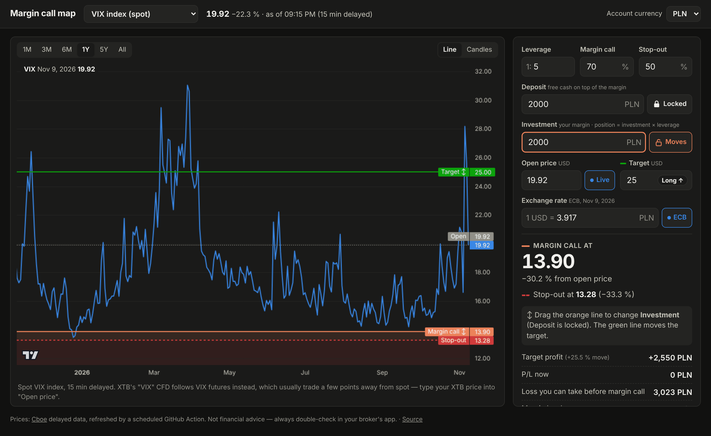

# Margin call map

**Live: [adamovix.github.io/cfd-margin](https://adamovix.github.io/cfd-margin)**

See **on the price chart where a CFD position gets margin-called**. Type your deposit,
investment and leverage, or just **drag the line** on the chart.

[](https://adamovix.github.io/cfd-margin)

- Orange line = margin call, red dashed line = stop-out, green line = target, grey dotted line = open price.
- Lock **Deposit** or **Investment**. Dragging the orange line changes the other one.
- **Target price** sets the direction: above the open price = long, below = short.
  Drag the green line to move it. Shows the profit at the target.
- **Account currency** (PLN, EUR, USD, GBP, CHF, CZK, HUF): deposit, investment, balance,
  P/L and profit/loss are in your currency; prices and position size stay in USD.
  The rate is the ECB daily reference rate, or type your broker's.
- Prices: VIX (spot), VIX futures (front month, which most VIX CFDs track), S&P 500.
  "Other" lets you type any price.
- Settings are saved in the URL (bookmark or share a setup) and in your browser.
  There is no backend.

## Where the prices come from

Cboe publishes free delayed quotes, but only lets browsers on cboe.com read them (CORS).
So the page can't fetch them itself. Instead the workflow in
`.github/workflows/pages.yml` runs `scripts/fetch-data.mjs` and publishes the data next to
the page on GitHub Pages:

- every 15 min on weekdays, 12:00–22:00 UTC (US trading hours), plus once after the futures settle;
- the open page checks for new data every 2 minutes.

So prices are **15 min delayed by Cboe, plus up to ~15–20 min until the next run**.
Exchange rates come from the [ECB daily reference rates](https://www.ecb.europa.eu/stats/policy_and_exchange_rates/euro_reference_exchange_rates/html/index.en.html) in the same run.
VIX futures are end-of-day settlement prices. You can always type the price from your
broker into **Open price**.

To add an instrument, add an entry to `INSTRUMENTS` in `scripts/fetch-data.mjs`.
It works for any symbol with history on Cboe's delayed quotes.

## The math

```
fx               = account currency per 1 USD (e.g. 3.92 PLN)
direction        = long if target > open price, short if target < open price
account balance  = deposit + investment                       (account currency)
units            = investment / fx × leverage / open price
equity(P)        = balance ± units × (P − open price) × fx     (+ long, − short)
used margin(P)   = units × P / leverage × fx                   (recalculated at the current price)
margin level(P)  = equity(P) / used margin(P)
```

The margin call price is the `P` where the margin level equals your margin call %.
Same for stop-out. With a constant rate, `fx` cancels out, so the lines depend only on
the deposit/investment ratio. The rate only changes position size and units.

**Not included:** other positions on the same account, swaps/overnight fees, spread,
exchange-rate moves after you open (if your currency weakens against USD, the lines move
closer), rollover gaps, and price gaps (price can jump past the line).

Margin call and stop-out levels differ between brokers and account types, so check yours.

## Code

| File | What it does |
|------|--------------|
| `js/margin.js` | The math above (no DOM) |
| `js/chart.js` | Chart, shaded zones, legend, dragging the lines |
| `js/app.js` | Settings, data loading, the side panel |
| `js/settings.js` | Saving settings in the URL and browser |
| `js/format.js`, `js/dom.js` | Small helpers |
| `scripts/fetch-data.mjs` | Downloads prices and exchange rates (run by the workflow) |

## Run locally

```bash
npm run data     # downloads prices into ./data
npm run serve    # http://localhost:8000
npm test         # unit tests
```

Chart: [TradingView Lightweight Charts™](https://github.com/tradingview/lightweight-charts)
(Apache 2.0, vendored in `vendor/`). Not financial advice.
